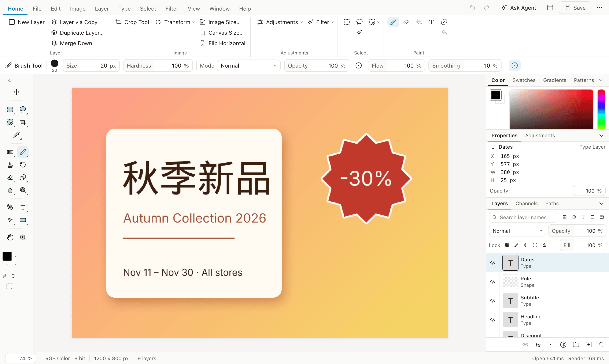
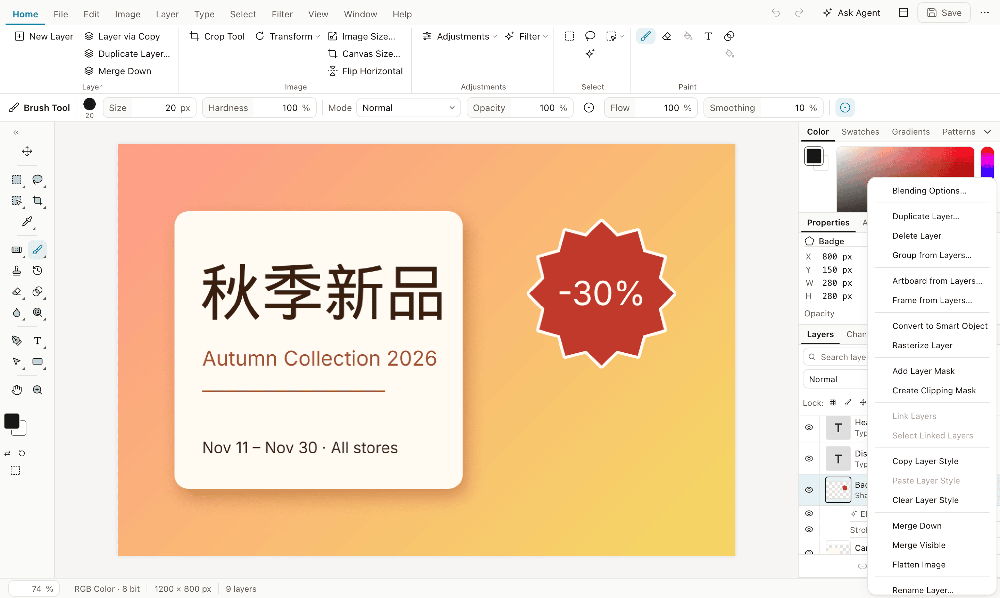
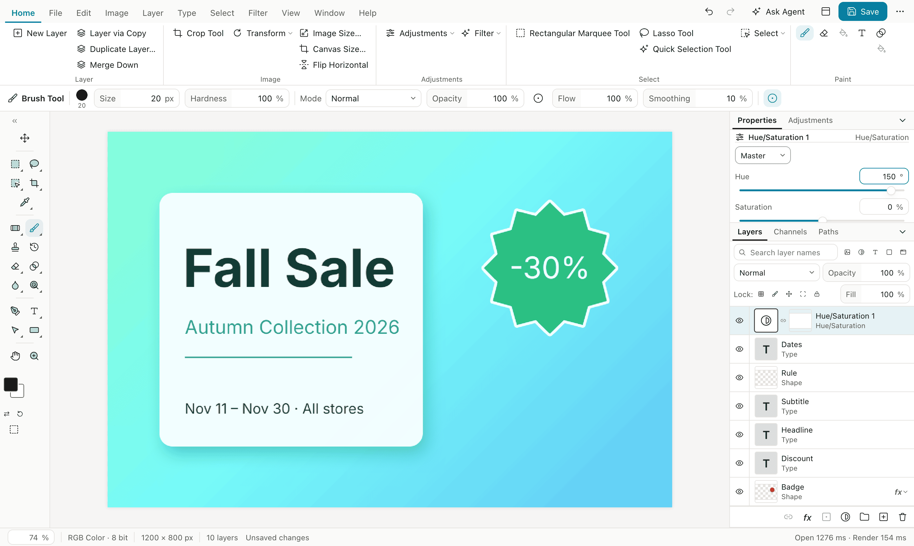
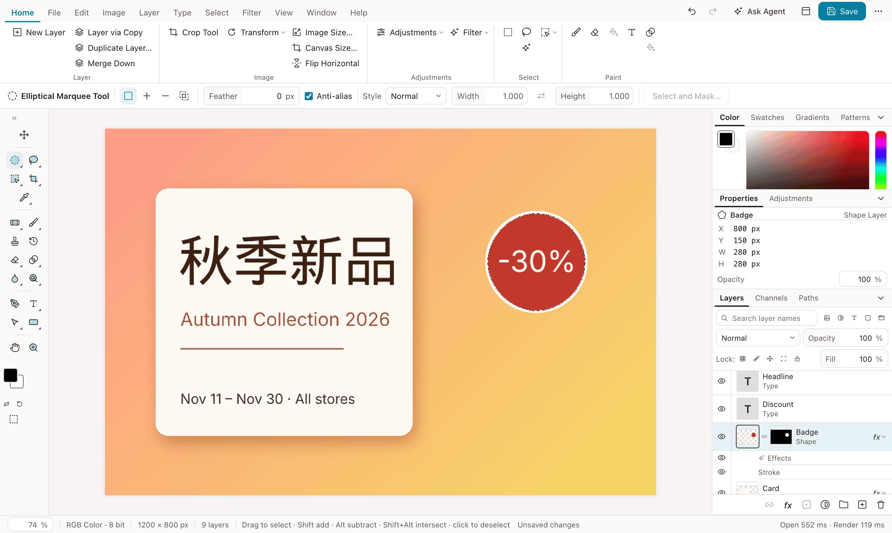
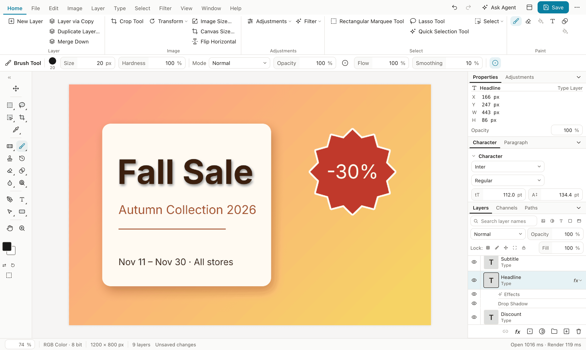
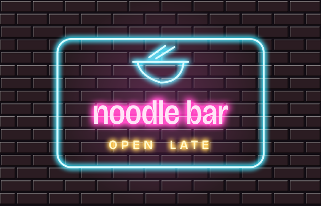
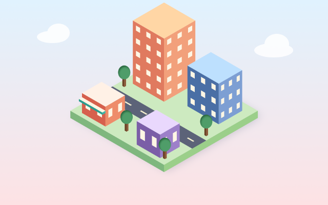
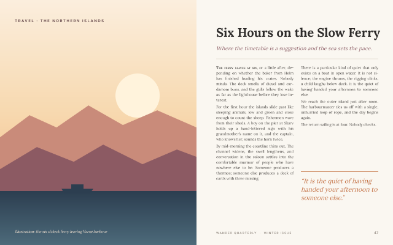

<div align="center">

# Kition Photo

**Kition Photo: a layered image editor that opens .psd files, for people and AI agents**

Layers and blend modes · Adjustment layers · Masks · Type, CJK included · Layer styles · MCP tools for agents

[](LICENSE)
[](https://www.npmjs.com/package/@kition/embed)
[](https://github.com/kitharness/kitharness)
[](bindings/wasm)

[Use it in Kition](https://kition.ai) · [Embed it](#embed-it-in-your-app) · [Give it to your agent](#give-it-to-your-agent) · [Showcase](https://github.com/KitionAI/kition-showcase/tree/main/photo) · [Developer docs](https://developer.kition.ai) · [KHP](https://github.com/kitharness/kitharness)

</div>

A layered image tends to stay locked in the app that made it. Open a `.psd` anywhere else and you
often get a flat picture: the type is pixels, the adjustments are baked in, the layers are gone.
An AI agent asked to change one word on a poster has the same problem. It sees pixels, not the
text layer.

Photo opens the `.psd` itself and keeps it layered. You work in an editor with a toolbox,
an options bar and Layers, Properties and Adjustments panels, and save back to `.psd`. An AI agent
works on the same file through the same engine: it reads the layer stack, changes a layer by its
name, and checks the result before it hands the file back to you.



## What it does

### Why Photo

- **Your `.psd` stays layered.** Layers, groups, blend modes, opacity, layer masks, clipping masks,
  type, object layers and solid color fill layers survive saving to `.psd` and opening again.
- **Adjust without touching pixels.** Levels and Hue/Saturation are adjustment layers: change
  them, hide them or delete them later, and the layers below stay as they were.
- **Type that stays text.** Point text, Chinese, Japanese and Korean included, stays an editable
  type layer, with Drop Shadow and Stroke styles that are saved with it.
- **Built for agents.** An agent inspects the layer stack, runs the editor's own commands on a
  layer by name or id, and checks the file for problems. It can work in a draft that you review.
- **Embeds in any web page.** The editor runs in a sandboxed frame on your own origin, over your
  storage and your users. No Kition server in the loop.
- **Open source.** Apache-2.0, engine and editor. The engine is Rust, compiled to WebAssembly, so
  the same code draws the editor and serves agents.

### See it

<table>
<tr>
<td width="50%"><br /><b>Layers</b>: blend modes, opacity, groups, masks and styles on every layer; right-click a layer for what you can do with it.</td>
<td width="50%"><br /><b>Adjustment layers</b>: recolor the whole poster with one layer you can change or hide later.</td>
</tr>
<tr>
<td width="50%"><br /><b>Masks from selections</b>: draw a selection, add a mask, and the hidden pixels stay on the layer.</td>
<td width="50%"><br /><b>Type and layer styles</b>: the headline stays text, with a drop shadow added from the Layers panel.</td>
</tr>
</table>

### Made with Photo

<table>
<tr>
<td width="25%"><a href="https://github.com/KitionAI/kition-showcase/tree/main/photo/neon-noodle-bar-sign"></a></td>
<td width="25%"><a href="https://github.com/KitionAI/kition-showcase/tree/main/photo/cinematic-color-grade"></a></td>
<td width="25%"><a href="https://github.com/KitionAI/kition-showcase/tree/main/photo/isometric-city-block"></a></td>
<td width="25%"><a href="https://github.com/KitionAI/kition-showcase/tree/main/photo/magazine-feature-spread"></a></td>
</tr>
</table>

Every sample is built with Photo's own commands. [See all of them](https://github.com/KitionAI/kition-showcase/tree/main/photo).

### Formats

| Opens | Creates | Exports |
| --- | --- | --- |
| `.psd`, `.psb`, `.kphoto` | `.psd` | `.png`, `.jpg`, `.tiff`, `.webp` |

## Quick start

### Use it in Kition

Open a `.psd`, `.psb` or `.kphoto` file in Kition and it opens in this editor. Kition's agent
works on the same file while you do. [Download Kition](https://github.com/KitionAI/kition/releases/latest).

### Embed it in your app

Photo's editor is a static package you host yourself, mounted into your page with the Kition
SDK's [`@kition/embed`](https://www.npmjs.com/package/@kition/embed). You keep the files and the
users; the editor reads and writes through the functions you give it.

1. Download `kition-photo-<version>.tgz` from the
   [latest release](https://github.com/KitionAI/kition-photo/releases/latest) and serve its
   `photo-ui/` folder as static files on its own origin, with the headers in the
   [embed reference](https://github.com/KitionAI/kition-sdk/blob/main/docs/platform/reference/embed.md).
2. Install the SDK and mount the editor:

```sh
npm install @kition/embed
```

```ts
import { KitionEmbed } from '@kition/embed'

const editor = await KitionEmbed.mount(document.getElementById('photo')!, {
  kit: { id: 'kit.photo', url: 'https://kits.example.com/photo-ui/' }, // the package you host
  file: { id: 'autumn-sale', name: 'Autumn sale.psd' },
  storage: {
    read: async (id) => api.read(id),                    // { bytes, version }
    write: async (id, bytes, { expectedVersion }) =>     // refuse a stale version
      api.write(id, bytes, expectedVersion),             // { version }
  },
})
```

Every save carries the version it read, so an edit made elsewhere is never written over. The
[embed guide](https://github.com/KitionAI/kition-sdk/blob/main/docs/sdk/embed.md) covers identity,
co-editing and an agent working inside the open editor.

### Give it to your agent

The engine also runs headless, and `kition`, the Kition SDK's command line, serves it as MCP tools
(`photo_inspect`, `photo_run`, `photo_check`, ...) on a folder of images, for any MCP client.
Nothing is compiled: you need neither Rust nor the Kition app. Install `kition`, then connect your
agent in the folder:

```sh
curl -fsSL https://github.com/KitionAI/kition-sdk/releases/latest/download/install.sh | sh
# Claude Code, in the folder:
claude mcp add kition -- ~/.kition/bin/kition mcp --workspace "$PWD"
```

On Windows, install it with
`irm https://github.com/KitionAI/kition-sdk/releases/latest/download/install.ps1 | iex`. With
Node.js 20 or later you can skip the install:
`claude mcp add kition -- npx -y @kition/kits-mcp --workspace "$PWD"`.

`kition` holds no kit. The first time the agent opens a `.psd` or `.kphoto` file, through the
`kit_inspect` tool the server offers until Photo is installed, `kition` downloads Photo's headless
executable into `~/.kition/kits` and the photo tools appear. `kition kit install photo` downloads it
ahead of time, and `kition kit upgrade` moves it to the newest version. Claude Desktop, Cursor,
Codex and the other commands are in the SDK's
[agent guide](https://github.com/KitionAI/kition-sdk/blob/main/docs/sdk/agent.md#connect-your-agent)
and [`kition` guide](https://github.com/KitionAI/kition-sdk/blob/main/docs/sdk/cli.md). To run a
build of your own (working on the kit itself), see
[docs/development.md](docs/development.md#build-and-test).

A real session on a copy of the showcase poster, abridged:

```text
> photo_inspect {"path":"poster.psd","preview":false}
Opened `poster.psd`: 1200 x 800 px, Rgb, 8-bit, 9 layers
  5 Discount  Type   "-30%"
  4 Badge     Shape  fill #c0392b, effects: Stroke
  3 Card      Shape  fill #fffaf2, effects: Drop Shadow
  …

> photo_run {"path":"poster.psd","steps":[
    {"command":"type.edit","params":{"layer":"Discount","text":"-40%"}},
    {"command":"shape.edit","params":{"layer":"Badge","fill":"#2e7d5b"}}]}
Ran 2 commands on `poster.psd` (saved): 1200 x 800 px, Rgb, 8-bit, 9 layers Changes: objects 2 changed.

> photo_inspect {"path":"poster.psd","preview":false}
  5 Discount  Type   "-40%"
  4 Badge     Shape  fill #2e7d5b, effects: Stroke
  …

> photo_check {"path":"poster.psd"}
Checked `poster.psd`: no errors, no warnings, 1 note.
  photo.font-substituted (info) layer:6: Type layer "Headline" asks for Inter at weight 700, which
  no font here has, so it is drawn at weight 600. […]
```

The layer lines and the note are trimmed from the JSON the tools answer. The note comes from an
executable without fonts: one built with `KITION_FONTS_DIR`
([docs/development.md](docs/development.md#fonts)) draws every weight of Inter as the editor does.
The agent's guide is [agent/guide.md](agent/guide.md).

## Maturity

Version 0.1.0 · KHP 1.0, conformance level `basic`.

| Works today | Partly there | Not yet |
| --- | --- | --- |
| Layers, groups, blend modes and opacity, saved to `.psd`<br />Levels and Hue/Saturation adjustment layers<br />Layer masks from selections, and clipping masks<br />Type, CJK included, with Drop Shadow and Stroke styles<br />Object layers and their contents | Filters: blur, noise, distort, stylize<br />Making, saving and loading selections<br />Free Transform and warps<br />Paths and shapes<br />Color profiles and image modes | A full color picker dialog<br />The Raw Develop dialog<br />Printing from the editor<br />Preferences dialogs |

Known gaps: [docs/gaps.md](docs/gaps.md). What's next: [docs/roadmap.md](docs/roadmap.md).

## Build and contribute

Build and test instructions are in [docs/development.md](docs/development.md). Read
[CONTRIBUTING.md](.github/CONTRIBUTING.md) before opening a pull request, and ask questions in
[Discussions](https://github.com/KitionAI/kition/discussions) or on [Discord](https://discord.gg/bFSjRDjVY).

## License

Apache-2.0 ([LICENSE](LICENSE)). Third-party licenses and notices are listed in [NOTICE](NOTICE)
and [docs/attribution.md](docs/attribution.md).

Portions of this kit are derived from a project licensed under the MIT License, used here under
that license and credited in [NOTICE](NOTICE).
